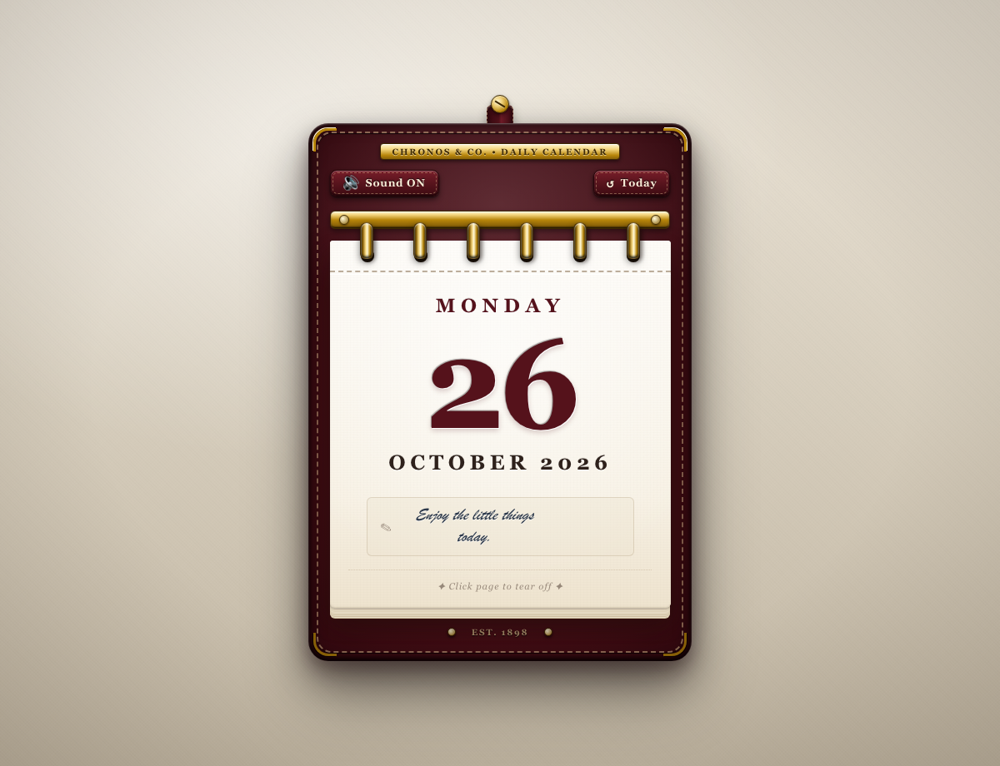

# 🗓️ Tear-off Calendar • Skeuomorphic Wall Calendar

<p align="center">
  <a href="https://x0suji0x.github.io/DevClub1/">
    
  </a>
</p>

<p align="center">
  <strong>A realistic, physics-inspired vintage tear-off daily wall calendar built entirely with vanilla web technologies.</strong>
</p>

<p align="center">
  <a href="https://x0suji0x.github.io/DevClub1/"><strong>🌐 Live Demo: x0suji0x.github.io/DevClub1</strong></a>
</p>

<p align="center">
  
  
  
  
  
</p>

---

## ✨ Design & Skeuomorphic Craftsmanship

Every texture, reflection, shadow, and tactile material detail is rendered with pure **CSS3** — zero external images, textures, web fonts, or icon libraries:

* **Warm Plaster Wall**: Multi-layered directional `radial-gradient` spotlighting and ambient room vignettes combined with repeating micro-gradients to simulate a physical plaster wall.
* **Burgundy Leather Backing**: Deep burnished leather patina with a continuous dashed gold thread stitched border, inset bevel highlights, brass mounting screw, and leather hanging strap.
* **Antique Brass Spiral Binding**: 3D cylindrical brass loops featuring specular highlight lines, aged patina shadows, and mounting plate bolts that pass directly through punched paper holes.
* **Thick Stacked Paper Edge**: Alternating multi-stop `box-shadow` depth layers beneath the cream sheet to create the illusion of 300+ physical pages remaining on the pad.
* **Embossed Letterpress Typography**: Heavy burgundy serif typography with two-tone inset and drop text shadows.
* **Perforated Tear Line**: Embossed crease line positioned beneath the spiral binding rings.

---

## ⚡ Key Features

### 1. Interactive 3D Paper Tear
* Clicking the page or pressing <kbd>Space</kbd> / <kbd>Enter</kbd> tears off today's page.
* Features a 3D swing-and-tumble keyframe animation (`perspective`, `transform-origin: top`, and `rotateX`/`rotateZ`).
* The upcoming day's sheet is rendered underneath in advance, seamlessly appearing as the current sheet falls away.
* Includes an animation lock (`isTearing`) to prevent accidental multi-day skips on rapid clicking.
* Respects `@media (prefers-reduced-motion: reduce)` by immediately switching dates without motion.

### 2. Web Audio API Paper-Tear Synthesizer
* Procedurally generates a crisp paper-tear sound on each rip using the native browser **Web Audio API**.
* Synthesizes a stochastic white-noise burst modulated with micro-pops (perforation teeth snapping) and tuned through bandpass (2200 Hz) and highpass (900 Hz) filters.
* Completely self-contained — no external `.mp3` or `.wav` files required.
* Includes a tactile leather/brass **Sound ON / Sound OFF** toggle.

### 3. Hidden Personal Daily Notes
* Clicking the handwritten quote at the bottom opens an in-theme vintage note editor.
* Lets you jot down daily reminders, events, or memories for any specific date.
* Automatically persists notes in `localStorage` keyed by `calendar-note-YYYY-MM-DD`.
* Reverting or clearing a note restores the default inspirational daily quote.
* Built strictly using safe DOM APIs (`.textContent`) to prevent XSS vulnerabilities.

### 4. Real-time Date Engine
* Reads the user's actual local device date upon loading.
* Seamlessly handles month rollovers, leap years (e.g. Feb 28 → Feb 29 on leap years), and year transitions (Dec 31 → Jan 1).
* Features a tactile **Reset to today** button to immediately jump back to the present day.

---

## 🎮 Controls & Keyboard Navigation

| Input / Control | Action |
|---|---|
| **Click Sheet** | Tears off the active page and advances to the next day |
| **<kbd>Space</kbd> / <kbd>Enter</kbd>** (on page) | Tears off the page when the calendar sheet has focus |
| **Click Handwritten Note** | Opens the Daily Note editor dialog for the current date |
| **<kbd>Tab</kbd>** | Navigates between Sound Toggle, Today Button, Calendar Page, and Note Area |
| **Sound Toggle** (🔊 / 🔇) | Mutes or unmutes synthesized paper-tear sound effects |
| **Today Button** (↺) | Resets the displayed date back to the current real date |
| **<kbd>Esc</kbd>** | Closes the open note editor without saving |

---

## 📂 Project Structure

```text
DevClub1/
├── index.html            # Semantic HTML5 layout, ARIA attributes & modal dialog
├── style.css             # Skeuomorphic styling, custom properties & 3D animations
├── script.js             # Date logic, Web Audio synthesizer & localStorage handling
├── calendar-preview.png  # High-resolution screenshot of the rendered calendar
└── README.md             # Project documentation and guide
```

---

## 🚀 Running Locally

### Direct File Execution
Simply double-click `index.html` or open it with any modern web browser (Chrome, Safari, Firefox, Edge, Brave).

### Local HTTP Server
```bash
# Using Python
python3 -m http.server 8000

# Using Node.js (npx)
npx serve .
```
Navigate to `http://localhost:8000` in your browser.

---

## 🌐 Deployment

This project requires no build tools or compilation. It is immediately ready for static hosting:

* **GitHub Pages**: Go to **Settings > Pages** → Select branch `main` and folder `/ (root)` → **Save**.
* **Netlify Drop**: Drag and drop the folder into [app.netlify.com/drop](https://app.netlify.com/drop).
* **Vercel**: Import repository and deploy with default static configuration.

---

## 📄 License

Open-source under the [MIT License](LICENSE) — free to use, modify, and learn from!
